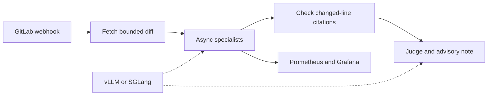

# MR Sentinel

Multi-agent merge request review for self-hosted vLLM or SGLang, with a GitLab DevSecOps pipeline and an evaluation gate.

[](https://github.com/jatinmallarapu/mr-sentinel/actions/workflows/ci.yml) [MIT license](LICENSE)

| Evaluation | Dataset | Precision | Recall | F1 | Status |
| --- | --- | ---: | ---: | ---: | --- |
| Deterministic provider | 20 synthetic fixtures | 1.00 | 1.00 | 1.00 | Offline smoke gate |
| Bandit 1.9.4 | Same 20 fixtures | 1.00 | 1.00 | 1.00 | Local scanner baseline |
| vLLM and SGLang model comparison | Frozen public holdout | — | — | — | Pending GPU and dataset |

The fixture provider recognizes a planted test marker. Its score verifies review routing, citation checks, and release gating. Bandit also detected all ten credential-like constants and produced no false alarms on these fixtures. These cases cannot establish whether the multi-agent reviewer adds value over static analysis.



## Reproduce locally

Use Python 3.11+ and install with `python -m pip install -e '.[dev]'`. Windows users without Make can run the commands from the Makefile directly.

```sh
make dev
make test
make eval
```

The demo renders one advisory note from a synthetic diff. `make eval` saves a report under `runs/`. Run `python evals/gap_analysis.py runs/smoke.json` to inspect error categories.

To reproduce the scanner row, install with `python -m pip install -e '.[baseline]'` and run `python evals/bandit_baseline.py`. The scanner reads complete added Python files from the fixtures. Evaluating a partial real diff requires a trusted checkout of its full revision.

## Connect a model and GitLab

Set the model, engine, and HTTP endpoint in `config.yaml`. Start the gateway with `make serve`. To enable GitLab events, set the variables in `.env.example` in the worker environment. Configure a merge request webhook at `/webhook/gitlab` with the same secret. Use a project-scoped token with note-write access. Keep `/review` and `/metrics` on a trusted network. The webhook returns an acceptance status immediately, and the background task posts an advisory note.

For real-model scoring pass a labelled JSONL file to `python evals/run_eval.py --dataset PATH --output runs/model.json`. The benchmark client measures end-to-end review latency and completed reviews per second. Sample GPU memory and server-token counters from the running backend and retain the raw logs before comparing settings. [Dataset contract](evals/DATA_CARD.md) · [GitLab merge requests API](https://docs.gitlab.com/api/merge_requests/)

## Deployment and operational limits

The chart packages an internal API service and an optional single-GPU vLLM deployment. The Grafana dashboard consumes Prometheus scrape data. Separate scanner outputs can be provided to a trusted local `/review` caller. [Architecture and rollout requirements](docs/architecture.md)

Use `helm template sentinel deploy/helm/mr-sentinel` to inspect the chart. Build and load the gateway image before installing on kind. The Ray Serve entry point at `deploy/ray/serve_app.py` is an alternate API deployment targeting the same external model endpoint. It needs a Ray Serve environment and integration testing before use.

The local worker uses in-process background tasks. Retried deliveries can post multiple notes, and a restart can lose queued work. A production webhook needs durable, revision-aware delivery handling and authenticated routing. The model path still needs a licensed held-out benchmark, a GPU comparison, and an actual Kubernetes failure drill. GitLab scans, mirroring, and Verified commits require account setup. This is a personal portfolio project.
