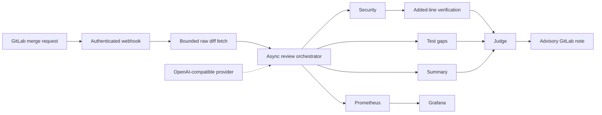

# Architecture

The webhook uses a configured origin and project ID. The diff and scanner summary have no authority to issue tool calls. The local review endpoint accepts scanner summaries from trusted callers. GitLab delivery deduplication, durable queueing, scanner artifact ingestion, and revision-aware posting are required before production use.

The gateway liveness probe measures the API process. The optional GPU service has its own model readiness probe. Pin image digests and set workload-specific timeouts for a real deployment.
